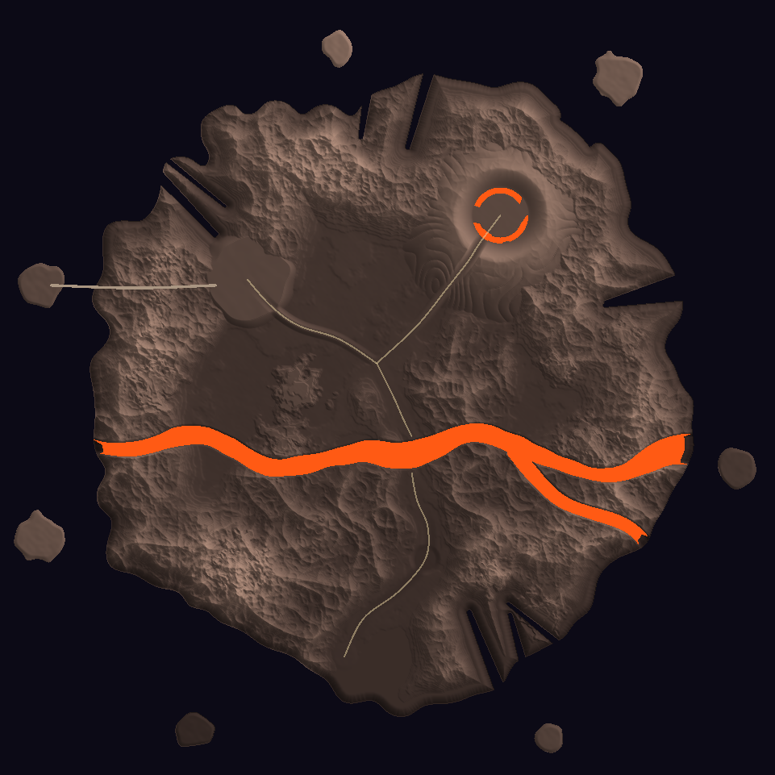

# Aetherion: The Incipient Engine (showcase)

A solo action-RPG prototype in **Unreal Engine 5 (C++)**, set in a mythological universe of my own design. This is a **selected excerpt** of the project. The full codebase, including the adaptive enemy AI and world-generation tooling, is private, so these files show the work but won't build on their own.

*Serrath's Scar, the first world region: a procedurally generated volcanic floating island with a lava rift, a caldera and Bastion ruins.*

## The full project

- **Combat (the Shard Warden):** a four-hit staff combo with press-to-chain timing, hit-stop and camera shake. **Essence** energy powers **Inferno Cleave**, a three-stage chained attack ending in a ground slam and ring of fire. Also includes Essence hybridization, dodge with invincibility frames, lock-on and a custom HUD.
- **Adaptive enemies (the Cult of the Flux):** enemies profile how the player fights and adjust their tactics. There's also a two-phase boss with poise and stagger that learns within a fight. *(Private.)*
- **World:** Serrath's Scar is built from Python-generated terrain, with a world director for day and night, weather, eruptions and lava bombs. *(Private.)*
- **Pipeline:** Unreal Python editor scripts that build levels, materials, montages and lighting, plus assets modelled in Blender and Poly Haven (CC0) photoscans regraded to the region's palette.

## What's in this repo

| Path | What it is |
|---|---|
| `Source/Aetherion/Warden/` | The player character: combo system, Essence component, Inferno Cleave, Divine Crucible, HUD |
| `Scripts/setup_hero.py` | Editor script that builds the Cleave animation montages for the hero |
| `Scripts/setup_scar_look.py` | The region's lighting, fog, post-process and rock material setup |
| `Scripts/tune_scar_lighting.py` | The fix described below |

## A problem worth noting: the scene that went black

A lighting pass for the Scar rendered the level almost black in play mode. Four settings stacked up: a sun near the horizon at low intensity, near-black basalt, dense fog, and auto-exposure clamped with a negative bias. `tune_scar_lighting.py` fixes it without losing the mood. It raises the sun to about 24° at triple the intensity, lifts the sky light, halves the fog, unclamps exposure and lightens the rock. All of it hangs off one `BRIGHTNESS` value, so the script can be re-run to tune. The same values were folded back into `setup_scar_look.py` so a fresh setup doesn't bring the problem back.

## Assets

The hero is **Paragon: Sun Wukong** by Epic Games (free on Fab). Fab's license doesn't allow redistribution, so it isn't included.

## Notes

The design, asset choices, integration, playtesting and version control are mine.

**© 2026 Tawonashe Mapako. All rights reserved.** This code is shared for viewing only. No license is granted to copy, modify or redistribute it.
